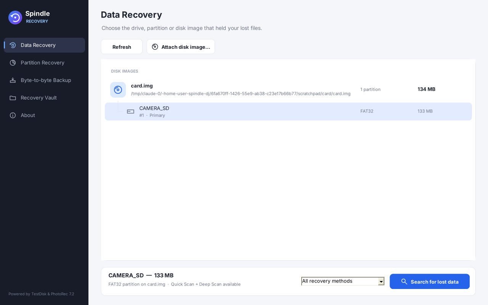
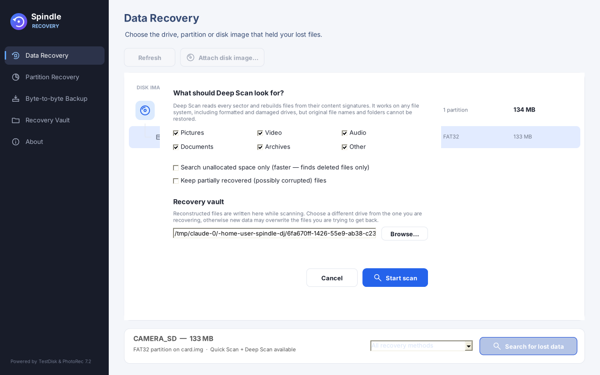
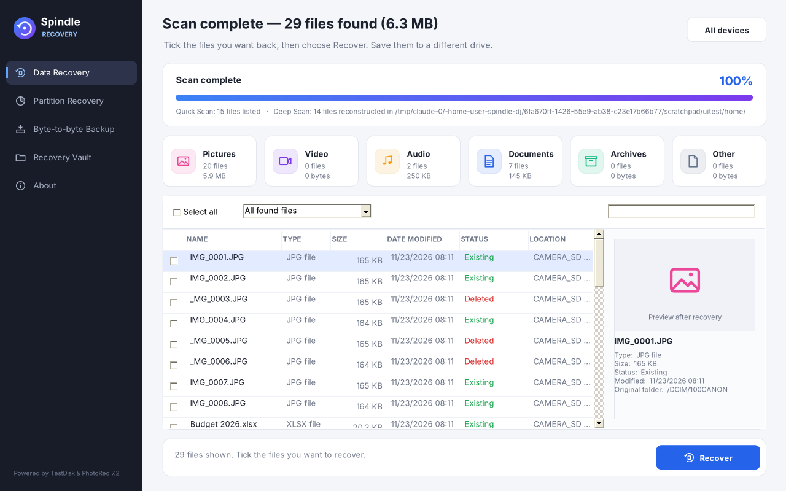
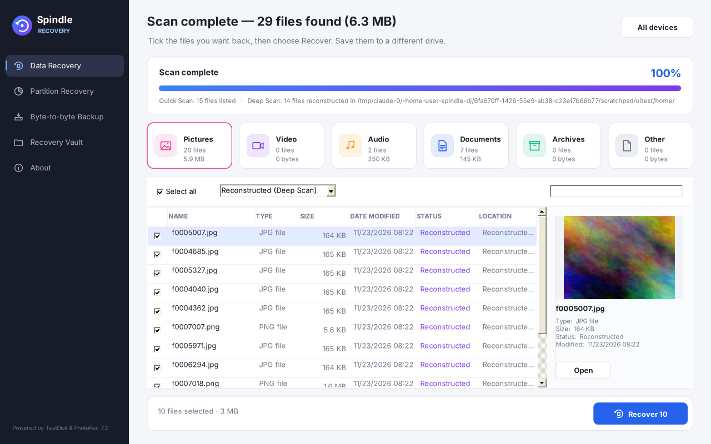
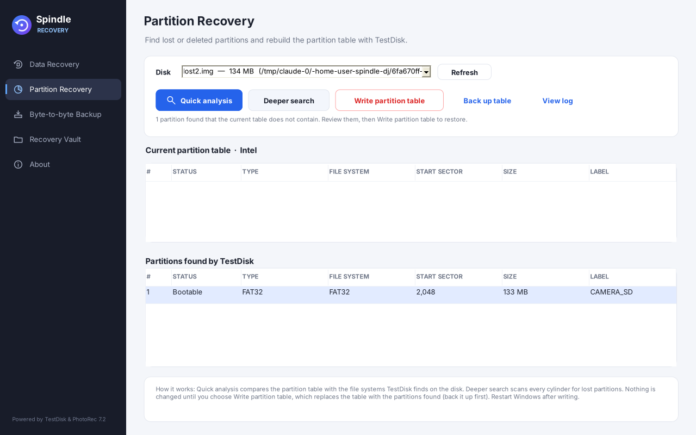

# Spindle Recovery

**A graphical data-recovery and partition-recovery app for Windows, built on TestDisk & PhotoRec 7.2.**

Pick a drive, press **Search for lost data**, tick the files you want back and press **Recover**. Under the hood it drives the real TestDisk and PhotoRec engines, compiled from the official 7.2 source, so you get their recovery power without the text-mode menus.



## Download

**[`bin/SpindleRecovery.exe`](bin/SpindleRecovery.exe)**: one 1.1 MB file, no installer. The TestDisk and PhotoRec engines are built in.

- Windows 10 or 11, 64-bit. It uses the .NET Framework 4.8 that ships with Windows, so nothing else needs installing.
- Windows asks for administrator rights when it starts, because reading raw disks requires them.
- SmartScreen may warn that the app is unrecognised, because it is not code-signed. Choose **More info → Run anyway**.
- Check the download with `certutil -hashfile SpindleRecovery.exe SHA256` against [`bin/SHA256SUMS`](bin/SHA256SUMS).

## What it does

| Tool | Engine | What it's for |
|---|---|---|
| **Quick Scan** | TestDisk (FAT/exFAT) + built-in NTFS reader | Lists deleted files **with their original names and folders**. On NTFS it reads the Master File Table directly, keeps files whose folder was also deleted, rates each file's **recovery chance** (good / partly overwritten / overwritten) from the free-space map, and **previews pictures before recovery**. It never writes to the source. |
| **Folder rebuild** (formatted NTFS) | built-in NTFS reader | Searches every sector of an NTFS partition for old file records left behind by a **quick format**, or by a damaged **RAW** volume, and rebuilds the **original folder tree and file names** from them. It uses the backup boot sector if the main one is damaged, and works out the cluster size itself if both are gone. Files whose folder record is gone appear under `Lost folders\Folder #N`. |
| **Deep Scan** | PhotoRec | Ignores the file system and rebuilds 480+ file formats (photos, RAW, video, audio, Office, PDF, archives…) from their content signatures. Works on formatted, corrupted, NTFS, exFAT, ext4, HFS+ and unknown file systems. |
| **Partition Recovery** | TestDisk | Finds lost or deleted partitions (quick analysis + deeper search), shows them next to the current table and rewrites the partition table. It backs up the old table first and asks for confirmation. |
| **Byte-to-byte Backup** | built-in | Images a failing disk or partition to an `.img` file. Unreadable sectors are retried one at a time and zero-filled. You can then scan the image instead of the dying drive. |

You can also attach disk images: `.img`, `.dd`, `.raw`, `.bin`, `.iso` or fixed `.vhd`. Use the button, drag the file onto the window, or pass its path on the command line.

| | |
|---|---|
|  |  |
|  |  |

### Using it

1. **Data Recovery** lists every disk with its partitions. Select a whole disk or one partition.
2. Under **Look for**, pick the kinds of files you want: **Pictures, Videos, Music, Documents, Email, Archives, Other files**, or **All types**. Hover a type to see the formats it covers.
   - For finer control, click **Formats…** and tick individual formats, for example only *JPEG* and *HEIC* photos, or only *Word/Excel 2007+* and *PDF*. A partly chosen type shows a count, such as "Pictures 2/11".
   - Fewer formats make a faster Deep Scan with less to sort through. Quick Scan results are filtered to the same choice, and the choice is remembered.
3. Choose a method, then **Search for lost data**:
   - **All recovery methods** (the default): Quick Scan, then folder rebuild on NTFS partitions, then Deep Scan.
   - **Quick Scan**: fast; deleted files with their names and folders.
   - **Deep Scan**: rebuilds files from their contents; works on any file system.
   - **Rebuild lost folders (formatted NTFS)**: for a drive that was quick-formatted or has turned RAW.
4. For Deep Scan, confirm the file types and pick a **recovery vault** folder. Put the vault on a *different* drive; the app warns you if you pick the drive being recovered.
5. Results arrive while the scan runs. Browse them in the **folder tree** (each partition's original folders, plus reconstructed files by type), or filter by category tile, by status (Deleted / Existing / Reconstructed / Lost after format) or by name. Pictures show a preview, even before recovery on NTFS.
6. Tick files and press **Recover**. Quick Scan files keep their folder structure; Deep Scan files are grouped by type.

Every scan is saved when it ends. **Saved scans…** reopens the results later without scanning again. Logs for every engine run are kept in `%LOCALAPPDATA%\SpindleRecovery\sessions`.

### Limits of this build

- **Quick Scan supports NTFS, FAT and exFAT.** ext2/3/4, HFS+ and APFS are recovered by **Deep Scan**, which works on every file system but cannot restore original names. NTFS-compressed and EFS-encrypted files are flagged; Quick Scan cannot rebuild them.
- **A stopped Deep Scan cannot be resumed yet.** Its results are saved, but continuing it starts again from the beginning (PhotoRec's resume only works in its text interface).
- **Not a forensic tool.** If the data matters a lot and the drive is failing physically (clicking, not detected), stop and contact a professional lab.
- **Testing.** Recovery logic was checked end to end on disk images. That covered undeleting files byte-for-byte, rebuilding a wiped partition table, carving deleted photos and documents, and imaging. Raw `\\.\PhysicalDriveN` access goes through TestDisk's own Win32 disk layer and was not exercised on real Windows hardware during development.

## How it's built

```
spindle-recovery/
├── engine/
│   ├── build-engine.sh          # fetches TestDisk 7.2, applies the patch, cross-compiles with MinGW-w64
│   └── patches/0001-spindle-recovery-gui-hooks.patch
├── gui/                         # C# WinForms app (.NET Framework 4.8), engines embedded as resources
│   ├── Engine/                  # runs the engines and parses their output
│   └── UI/                      # screens, custom-drawn controls and icons
├── tests/                       # unit tests (Mono) against real engine output and an NTFS image
│   └── windows/                 # end-to-end tests run by CI on real Windows with virtual disks
├── bin/SpindleRecovery.exe      # the compiled Windows app
└── build.sh                     # builds everything above
```

### Engine changes

The GUI drives `testdisk.exe` and `photorec.exe` in their scripted `/cmd` mode. TestDisk 7.2 was changed in four small, non-invasive ways ([the patch](engine/patches/0001-spindle-recovery-gui-hooks.patch), about 120 lines):

1. **Progress output.** Without the ncurses UI, PhotoRec printed no progress at all. It now prints `@@PROGRESS pass=… sector=… total=… files=…` once per second, in both the block-size pass and the carving pass.
2. **Graceful stop.** PhotoRec stops cleanly, keeping the files already recovered, when the file named by `PHOTOREC_STOP_FILE` appears.
3. **Selective undelete.** TestDisk's `filecopy` command copied a whole partition. It now copies only the paths listed in the file named by `TESTDISK_COPY_LIST`.
4. **Windows device paths.** `\\.\PhysicalDriveN` and `\\.\X:` given on the command line now open through TestDisk's native Win32 disk layer.

### Building from source (Linux or WSL)

```bash
sudo apt-get install mingw-w64 autoconf automake libtool pkg-config git dotnet-sdk-8.0 mono-devel
./spindle-recovery/build.sh        # → spindle-recovery/bin/SpindleRecovery.exe
```

`build.sh` clones the official `v7.2` tag from [github.com/cgsecurity/testdisk](https://github.com/cgsecurity/testdisk). That is the same release as `https://www.cgsecurity.org/testdisk-7.2.tar.bz2`; to build from the tarball instead, set `TESTDISK_TARBALL=/path/to/testdisk-7.2.tar.bz2`. The engines are then cross-compiled with MinGW-w64 as static binaries that depend only on Windows system DLLs. Finally, the GUI is built with the .NET SDK, which can target .NET Framework 4.8 from Linux. The `Spindle Recovery (Windows build)` GitHub Actions workflow does the same and publishes the `.exe` as an artifact.

Unit tests: `./spindle-recovery/tests/run-tests.sh` (needs Mono). They cover the parsers, the PhotoRec command line, NTFS recovery from a real NTFS image, and saved scans.

On every push, the **Spindle Recovery (Windows build)** workflow builds the app on Linux. It then tests it on a Windows runner:
1. `diskpart` creates FAT32 and NTFS virtual disks.
2. Windows writes files to them and deletes some.
3. The real `SpindleRecovery.exe` code and engines recover the deleted files from `\\.\PhysicalDriveN`, and every file is checked byte-for-byte.
4. Deep Scan, partition analysis, imaging and the engine security checks also run, and the GUI is launched and screenshotted.

### Security

The app runs as administrator, so it treats its own engines as part of its trusted code:
- They are extracted under `C:\Program Files\Spindle Recovery\engine`. That folder has its own permissions (administrators and SYSTEM: full control; users: read and execute).
- Before every launch, each engine is checked against the copy embedded in `SpindleRecovery.exe`. A missing or modified engine is restored.
- The engine file stays locked against writes, renames and deletes while it runs.
- The developer environment variable `SPINDLE_ENGINE_DIR` is ignored on Windows.
- Source drives are only ever opened read-only, except when you explicitly choose **Write partition table**.

### Code signing

The CI workflow signs the tested `.exe` with Authenticode when the repository has these secrets:
- `SIGN_PFX_BASE64`: the code-signing certificate, base64-encoded `.pfx`
- `SIGN_PFX_PASSWORD`: its password

Open-source projects can get a free certificate through [SignPath Foundation](https://signpath.org). A signed build removes the SmartScreen "unrecognised app" warning once it has built up reputation.

## Licence and credits

Spindle Recovery is free software under the **GNU General Public License v2 or later** ([COPYING](COPYING)), the same licence as TestDisk and PhotoRec.

- **TestDisk & PhotoRec** © Christophe GRENIER and contributors, <https://www.cgsecurity.org>. The source used is TestDisk 7.2 plus the patch in `engine/patches/`; `engine/build-engine.sh` rebuilds the exact binaries.
- The interface design, icons and code in `gui/` are original to this project. The layout follows the familiar "pick a drive → scan → review → recover" flow of modern consumer recovery apps, but Spindle Recovery is an independent project. It is not affiliated with, endorsed by, or derived from CGSecurity, CleverFiles/Disk Drill or any other vendor.

There is **no warranty**. Always recover to a different drive from the one you are recovering.
